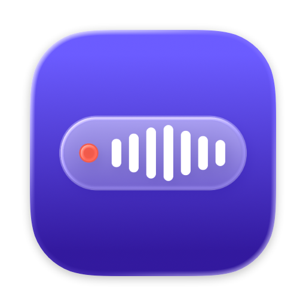
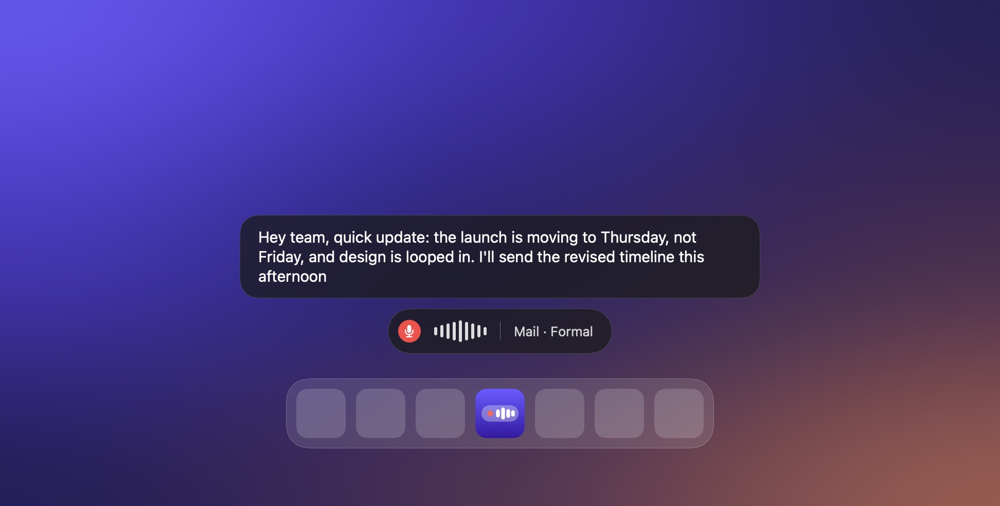
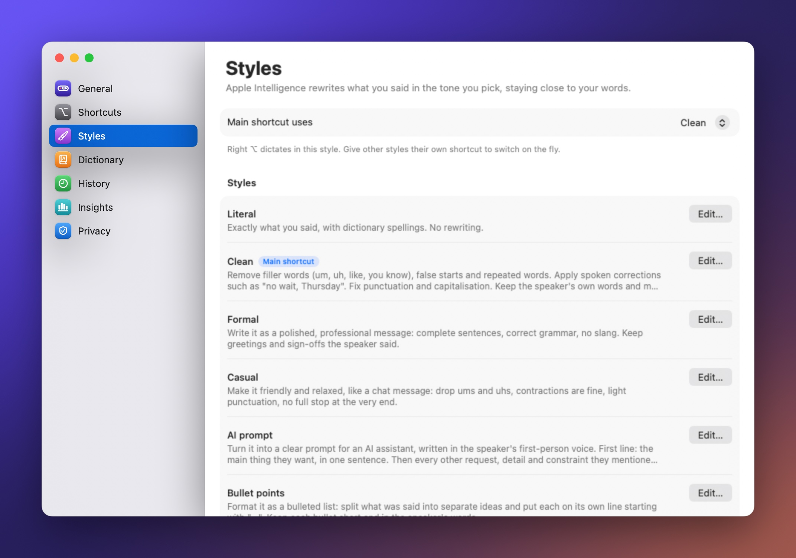
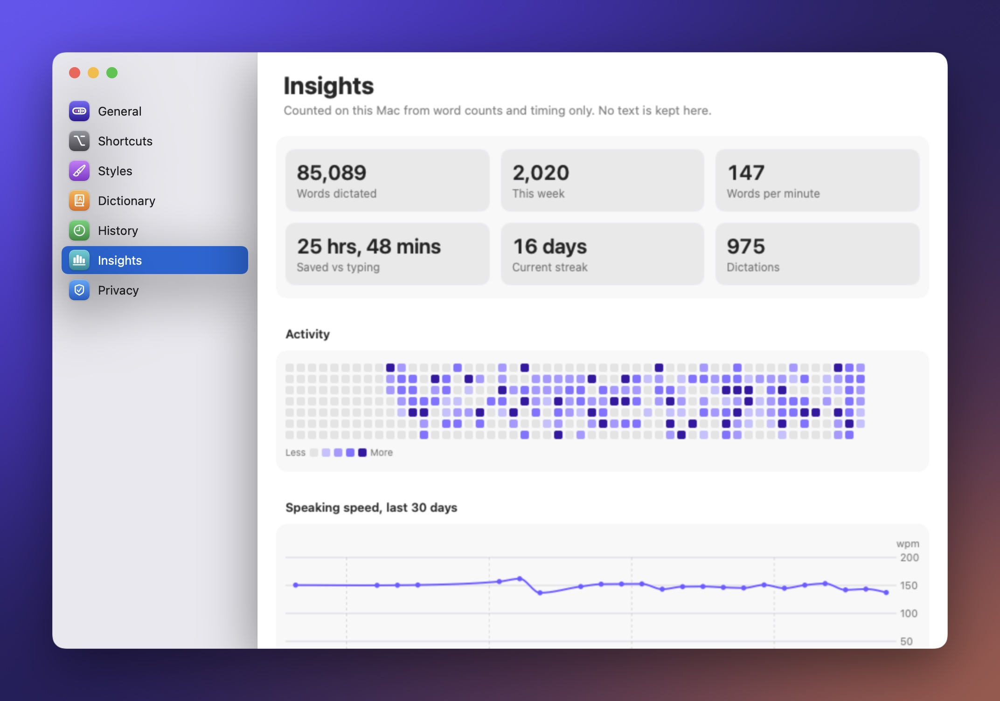
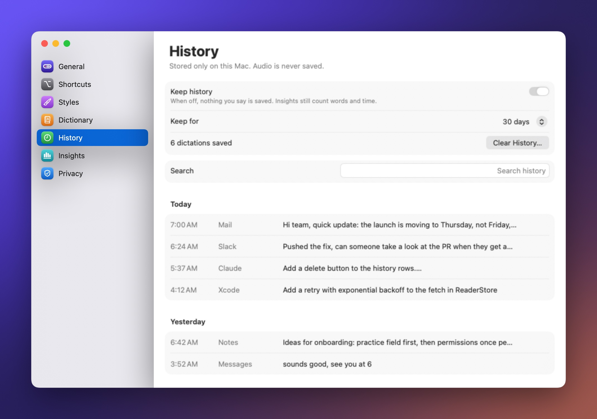
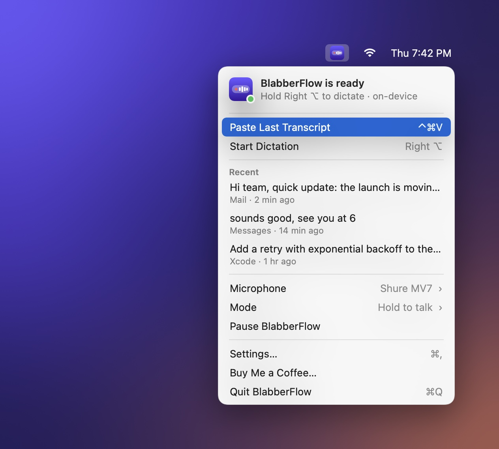

  

<h1 align="center">BlabberFlow</h1>

  <strong>Hold a key, speak in any app, and polished text appears.</strong> 
  On-device dictation for the Mac. No account, no cloud, nothing leaves your Mac.

  <a href="https://github.com/chrisyeeeh/Blabberflow/releases/latest/download/BlabberFlow.dmg"><strong>Download for Mac</strong></a>
  ·
  <a href="https://github.com/chrisyeeeh/Blabberflow/releases">All releases</a>
  ·
  <a href="https://buymeacoffee.com/Chrisyeh">Buy me a coffee</a>

## What it does

- **Hold to talk, anywhere.** Hold Right ⌥ (or any key you choose), speak, and let go. The text lands where your cursor is, in any app. Prefer hands-free? Switch to press-to-start, press-to-stop.
- **Styles, rewritten on-device.** Apple Intelligence rewrites what you said as Clean, Formal, Casual, Bullet points, or **AI prompt**, which turns a ramble into a clear prompt for an assistant. Write your own styles and give each its own shortcut.
- **A dictionary that gets names right.** Add words, names and acronyms. BlabberFlow hints them to the recogniser and fixes their spelling afterwards, even for "git hub", "a p i" or a misheard name.
- **Live preview.** Watch your words appear above the pill as you speak.
- **History and Insights.** Search what you've said, compare what was heard with what was typed, and rewrite an old dictation in another style. Insights shows your words per minute, streaks and a year of activity.
- **Long dictations too.** Twenty-minute monologues are styled in pieces, so nothing falls back to raw text.

| | |
| --- | --- |
|  |  |
|  |  |

## Requirements

- macOS 26 or later on Apple Silicon.
- Apple Intelligence for Styles (optional). Transcription uses Apple's on-device speech model and works with Apple Intelligence off; without it, BlabberFlow inserts exactly what you said.

## Install

1. [Download BlabberFlow.dmg](https://github.com/chrisyeeeh/Blabberflow/releases/latest/download/BlabberFlow.dmg). It's signed with a Developer ID and notarized by Apple.
2. Open it and drag **BlabberFlow** into **Applications**. Run it from Applications, not from Downloads or the disk image, or macOS won't keep its permissions.
3. Allow **Microphone** and **Accessibility** when asked. Accessibility lets BlabberFlow notice your shortcut in any app and type the result where your cursor is.
4. Hold **Right ⌥** and speak.

The first launch downloads Apple's speech model for your language. It's a one-time download, shared with other apps.

## Privacy

Everything happens on your Mac. Speech recognition uses Apple's `SpeechAnalyzer`, and rewriting uses the Apple Intelligence on-device model through `FoundationModels`. There are no servers, analytics or accounts. History is stored locally with SwiftData in `~/Library/Application Support/Blabberflow/`, and you can turn it off or clear it. Audio is never saved.

## Build from source

You need Xcode 26 or later.

1. Clone the repo and open `Blabberflow.xcodeproj`.
2. In the **Blabberflow** target's **Signing & Capabilities**, choose your own team. It needs a stable signing identity, or macOS forgets the Accessibility permission on every rebuild.
3. Press ⌘R.

The project uses Swift 6 with main-actor isolation by default. There are no third-party dependencies.

| Folder | What's in it |
| --- | --- |
| `Blabberflow/Hotkey` | The Core Graphics event tap that watches your shortcuts |
| `Blabberflow/Dictation` | Microphone capture, SpeechAnalyzer transcription, dictionary fixes, and Style rewrites |
| `Blabberflow/Insertion` | Typing into the focused field via Accessibility, with a paste fallback |
| `Blabberflow/Pill` | The floating pill and live preview |
| `Blabberflow/Menu` | The menu bar item and brand assets |
| `Blabberflow/Settings` | The Settings window and preferences |
| `Blabberflow/History` | The SwiftData store for history and Insights |

### Releasing

`scripts/release.sh` archives a Release build, signs it with your Developer ID, notarizes and staples the app, wraps it in a DMG, and notarizes the DMG too. Setup instructions are at the top of the script.

## Contributing

Issues and pull requests are welcome. Please keep it on-device: no network calls, analytics or third-party services.

## Support

BlabberFlow is free and made by one person. If it saves you time, you can [buy me a coffee](https://buymeacoffee.com/Chrisyeh).

## License

[MIT](LICENSE) © 2026 Christopher Yeh
